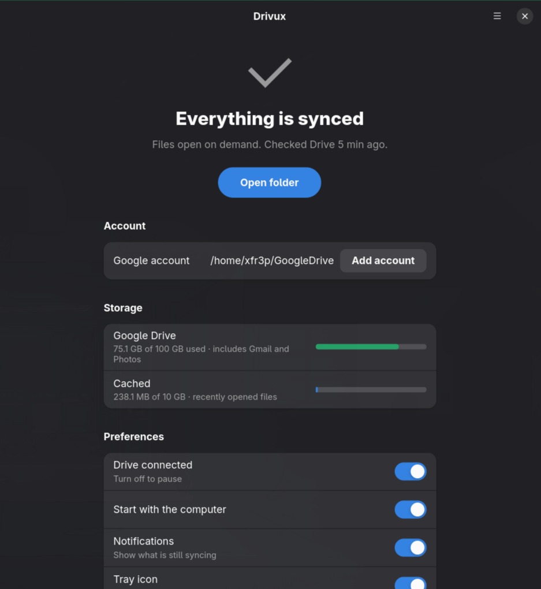

<div align="center">

# Drivux

**Google Drive on Linux, the way it works on Windows and macOS.**<br>
Your whole Drive in a folder. Files download only when you open them.

[](LICENSE)
[](https://github.com/xfr3pbr/drivux/releases)
[](https://github.com/xfr3pbr/drivux/stargazers)
[](https://github.com/xfr3pbr/drivux/commits)




[Install](#install) · [Features](#features) · [Instant folders](#instant-folders) · [Compatibility](#compatibility) · [FAQ](#faq) · [Roadmap](#roadmap)

</div>

---

## Why Drivux

Google never made a Drive client for Linux. The usual answers are a mount that is slow to open folders,
or a sync tool that copies your **entire** Drive to disk. Drivux gives you the third option:

- **Nothing is copied until you need it.** A 100 GB Drive does not need 100 GB of disk.
- **Folders open at once**, even right after boot and even offline, because the file list is kept on disk.
- **No config files.** Sign in with your browser, click Allow, done.
- Built on [rclone](https://rclone.org), the most trusted cloud-storage tool on Linux.

## Features

| | |
|---|---|
| **On-demand files** | See every file; each one is downloaded when you open it and cached (10 GB by default). |
| **Instant folders** | The list of your files lives in a local database, so folders are complete in ~0.2 s after a restart, with or without internet. |
| **Keep offline** | Right-click a file or folder in Nautilus and keep it available without internet. |
| **Several accounts** | Personal, work, school: each account gets its own folder, cache and settings. |
| **Tray icon** | Synced, syncing, paused or error at a glance. Hover to see which files are going up or down. |
| **Notifications** | Progress updated in place, and a separate alert when something fails. |
| **Fast uploads** | Local changes reach Drive in about a second. |
| **Native look** | GTK4 and libadwaita window with status, storage usage, pause and start-with-the-computer. |
| **Command line** | Everything the window does, plus `status`, `offline`, `account`... |

## Instant folders

By default rclone forgets the list of your files whenever it restarts, so for a few minutes after
boot some folders are slow to open. `drivux fast on` fixes that, the way Google Drive for desktop
does on Windows:

```
~/GoogleDrive   (Drivux: names come from a database on disk)
      |  open, read, write, rename, delete
      v
rclone mount (hidden)  ->  Google Drive
```

- Folders and file info are answered from `~/.cache/drivux/index.sqlite3`: ~0.2 s after a restart
  with 14 thousand files, with or without internet.
- Everything else goes to rclone, which keeps doing the cache and the uploads.
- Drivux reads the whole Drive tree in the background every 5 minutes to keep the list current.
  **Changes made on drive.google.com can take up to 5 minutes to show up** (about 10 s without it).
- The first time it reads the tree before showing the folder (about a minute).
- Needs `python-pyfuse3` (Arch) or `python3-pyfuse3` (Debian, Fedora). `drivux fast off` goes back.

## Install

Download the package for your distribution from the
[Releases](https://github.com/xfr3pbr/drivux/releases) page:

```bash
sudo apt install ./drivux_*_all.deb              # Ubuntu, Debian, Mint, Pop!_OS
sudo dnf install ./drivux-*.noarch.rpm           # Fedora
sudo pacman -U ./drivux-*-any.pkg.tar.zst        # Arch, Manjaro, EndeavourOS, Omarchy
```

Dependencies (rclone, FUSE, GTK, libadwaita) come along. Then open **Drivux** from your applications menu.

<details>
<summary>Other distributions with systemd</summary>

Install the [dependencies](#compatibility) and run:

```bash
git clone https://github.com/xfr3pbr/drivux && cd drivux
sudo make install PREFIX=/usr
```

Packaging details, and why there is no Flatpak/AppImage: [packaging/README.md](packaging/README.md).
</details>

## Quick start

```bash
drivux                          # open the window and connect your account
drivux fast on                  # instant folders (recommended)
drivux account add work         # connect a second Google account in ~/GoogleDrive-work
drivux offline add ~/GoogleDrive/Projects     # keep a folder available offline
drivux status                   # sync status of every account
```

## FAQ

**Is it safe?** Drivux talks to Google through rclone with the permissions you grant in your browser.
Nothing is sent anywhere else. Disconnecting removes the services, the cache and the access;
**nothing is deleted from Google Drive.**

**Does it use my disk?** Only for files you opened (up to 10 GB, removed after 30 days without use)
and for files you chose to keep offline.

**What happens if I delete a file in the folder?** It is deleted from Google Drive too (it goes to the Drive trash).

**Does it work offline?** Cached and kept-offline files open; the folder list also stays visible with Instant folders on.

**Why not just use rclone?** rclone is great, but you need to write the unit files, tune the mount flags
and watch the logs. Drivux does that and adds the window, tray, notifications, offline menu and accounts.

---

## Compatibility

Drivux is meant to work on **any Linux distribution** that has:

| Requirement | Why |
|---|---|
| **systemd** (user services) | keeps the folder mounted and starts it with the computer |
| **FUSE 3** | lets the folder show files that live in the cloud |
| **rclone 1.60+** | talks to Google Drive |
| **Python 3.11+, PyGObject, GTK 4, libadwaita 1.5+** | user interface |

Notifications use the freedesktop standard and work on GNOME, KDE, XFCE, Cinnamon,
Hyprland, Sway, etc. Program paths are detected on the system, not hardcoded.

If something is missing, Drivux shows the right install command for your distribution
(apt, dnf, pacman, zypper, apk, xbps, emerge).

| Distribution | Status |
|---|---|
| Arch, Manjaro, EndeavourOS, Omarchy | tested (Omarchy/Hyprland) |
| Fedora 40+, openSUSE Tumbleweed | should work (recent packages) |
| Ubuntu 24.04+, Debian 13+, Mint 22+ | should work; if the repository rclone is too old, Drivux points to the official installer |
| Debian 12, Ubuntu 22.04 and older | libadwaita too old for the interface (`drivux setup` from the terminal works) |
| Without systemd (Alpine, Void, Devuan, Gentoo with OpenRC) | not supported yet |

Installing the dependencies:

```bash
sudo pacman -S rclone fuse3 python-gobject gtk4 libadwaita                       # Arch
sudo dnf install rclone fuse3 python3-gobject gtk4 libadwaita                    # Fedora
sudo apt install rclone fuse3 python3-gi gir1.2-gtk-4.0 gir1.2-adw-1             # Ubuntu/Debian
sudo zypper install rclone fuse3 python3-gobject typelib-1_0-Gtk-4_0 typelib-1_0-Adw-1  # openSUSE
```

## How it works

| Piece | Location |
|---|---|
| Google account (rclone remote `drivux:`) | `~/.config/rclone/rclone.conf` |
| Drivux settings | `~/.config/drivux/config.json` |
| Service that mounts the folder | `~/.config/systemd/user/drivux.service` |
| Notification service | `~/.config/systemd/user/drivux-notify.service` |
| Tray icon service | `~/.config/systemd/user/drivux-tray.service` |
| Other accounts (name `work`) | remote `drivux-work:`, units `drivux@work.service` (and `drivux-front@work`, `drivux-notify@work`, `drivux-offline@work`), `~/.cache/drivux-work/`, `~/.config/drivux/offline-work.json` |
| Instant folders: service and the file list | `~/.config/systemd/user/drivux-front.service`, `~/.cache/drivux/index.sqlite3` |
| Files kept offline, and the daily timer that refreshes them | `~/.config/drivux/offline.json`, `~/.config/systemd/user/drivux-offline.{service,timer}` |
| Cache of opened files, and log | `~/.cache/drivux/` |
| rclone control socket (only your user can access it) | `$XDG_RUNTIME_DIR/drivux.sock` |

Disconnecting removes the services, the cache and the account access.
**Nothing is deleted from Google Drive.**

> **Warning:** deleting a file **inside the folder** deletes it from Google Drive too
> (it goes to the Drive trash).

## Known limitations

- Native Google documents (Docs, Sheets, Forms) do not show up in the folder.
- Offline, only files already in the cache can be opened. Use **Keep offline** for the ones you need:
  they are read again every day so the cache does not expire them, but everything kept offline
  still counts toward the 10 GB cache limit (`drivux offline list` shows what is kept).
- rclone's default Google Drive access (shared client ID) is being retired in 2026.
  To avoid depending on it, create your own client ID in Google Cloud and enter it
  under **Advanced** on the setup screen (or `drivux setup --client-id ... --client-secret ...`).

## Running from source

```bash
PYTHONPATH=src python3 -m drivux          # opens the interface
PYTHONPATH=src python3 -m drivux setup    # sets up from the terminal
PYTHONPATH=src python3 -m drivux status
make test
```

## Roadmap

- [x] On-demand Google Drive folder with a GTK4 interface
- [x] Notifications, "Keep offline" in Nautilus, tray icon
- [x] Instant folders, kept on disk (`drivux fast on`)
- [x] Several Google accounts
- [x] .deb, .rpm and Arch packages, install-tested in CI on Ubuntu, Debian, Fedora and Arch
- [ ] Follow the Drive change feed (about 10 s) instead of rescanning every 5 minutes
- [ ] Wizard to create your own Google Cloud client ID
- [ ] Status icons on files (cloud / available offline) in Nautilus
- [ ] Publish to the AUR (new AUR account registration is temporarily closed)
- [ ] Support for systems without systemd
- [ ] Other services supported by rclone (OneDrive, Dropbox…)

## Contributing

Issues and pull requests are welcome. Run `make test` before sending a change.
Drivux is a thin layer over rclone, so if something is a rclone limitation, the fix may belong there.

## License

GPL-3.0-or-later. See [LICENSE](LICENSE).
